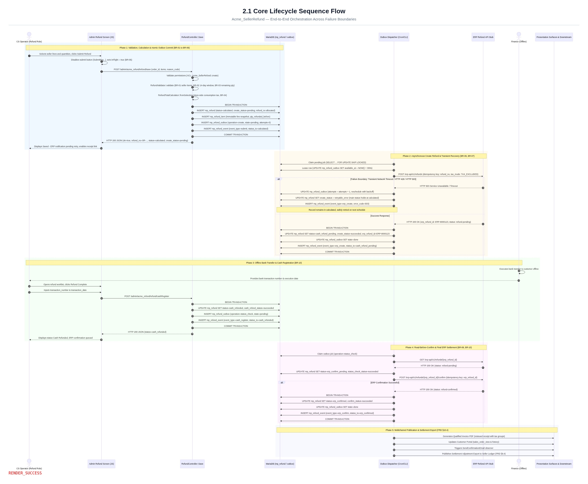
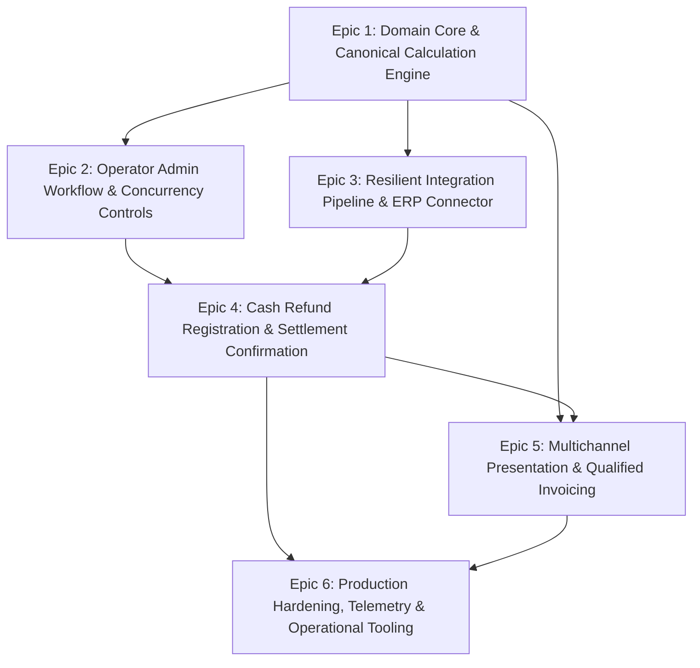

# 02 - Refund Design: End-to-End Flow & Phased Delivery Plan

This document establishes the target-state architectural design for the **Seller Return & Refund** subsystem (`Acme_SellerRefund`), including the end-to-end sequence flow across failure boundaries and an epic-level delivery plan with strict acceptance gates.

---

## 1. Architectural Design Principles

The design is governed by five foundational architectural principles derived from the functional requirements:

1.  **Transactional Decoupling (Commit Before Notify — BR-06):**
    Local financial records (`mp_refund`, `mp_refund_item`) and the initial outbound message are committed in a single local MariaDB transaction before any remote network call occurs. External HTTP communication is handled asynchronously via the **Transactional Outbox Pattern**, eliminating distributed transactions and preventing remote network latency from starving database connections.
2.  **Absolute Idempotency across Integration Boundaries (BR-07 & BR-08):**
    *   **Create Refund:** Governed by `refund_no` (format `SR-YYYYMMDD-NNNNNN`), generated locally at record creation. Retries must always send the identical `refund_no`.
    *   **Confirm Refund:** Governed by `erp_refund_id`, returned by the ERP upon credit note opening.
3.  **Strict State Machine Isolation (FRD § 7):**
    Main lifecycle states (`calculated`, `cash_refund_pending`, `cash_refunded`, `erp_confirm_pending`, `erp_confirmed`) represent confirmed business milestones. Transient network errors (timeouts, 429s, 5xx) update operational sub-statuses (`create_status`, `confirm_status`) and schedule backoff retries without corrupting the main lifecycle.
4.  **Read-Before-Confirm Guarantee (FRD § 1, § 4, § 9.2):**
    Because Finance performs offline cash transfers independently, the system explicitly enforces that the credit note must be confirmed as `refund-pending` on the ERP side before the settlement confirmation (`Confirm Refund`) is dispatched.
5.  **Canonical Money Engine & Single Source of Truth (FRD § 10.4, § 11):**
    All customer presentation surfaces (PDF receipt, customer portal, order history, transactional email) and downstream sync exports derive figures strictly from the stored refund snapshot via `RefundTotalCalculator`. First-party (core) merchandise is completely segregated from seller refund calculations.

---

## 2. End-to-End Sequence Diagram

The following sequence diagram details the end-to-end refund lifecycle, highlighting administrative submission, transaction boundaries, asynchronous outbox processing, transient failure handling, offline cash transfer registration, and final ERP settlement.

> **Diagram Image:** A rendered high-resolution image of this diagram is saved at [`submission/core-lifecycle-sequence-flow.jpg`](core-lifecycle-sequence-flow.jpg).



```mermaid
sequenceDiagram
    autonumber
    actor CS as CS Operator (Refund Role)
    participant UI as Admin Refund Screen (JS)
    participant Ctrl as RefundController::Save
    participant DB as MariaDB (mp_refund / outbox)
    participant Worker as Outbox Dispatcher (Cron/CLI)
    participant ERP as ERP Refund API Stub
    actor Fin as Finance (Offline)
    participant Surface as Presentation Surfaces & Downstream

    %% PHASE 1: SUBMISSION & ATOMIC STORAGE
    rect rgb(240, 248, 255)
    note over CS, DB: Phase 1: Validation, Calculation & Atomic Outbox Commit (BR-01 to BR-06)
    CS->>UI: Selects seller lines & quantities; clicks "Submit Refund"
    UI->>UI: Disables submit button ("Submitting..."), sets inFlight = true (BR-05)
    UI->>Ctrl: POST /admin/acme_refund/refund/save (order_id, items, reason_code)
    Ctrl->>Ctrl: Validate permissions (ACL: Acme_SellerRefund::create)
    Ctrl->>Ctrl: RefundValidator::validate (BR-01 seller items, BR-02 14-day window, BR-03 remaining qty)
    Ctrl->>Ctrl: RefundTotalCalculator::fromSelection (store-side consumption tax, BR-04)
    Ctrl->>DB: BEGIN TRANSACTION
    Ctrl->>DB: INSERT mp_refund (status='calculated', create_status='pending', refund_no allocated)
    Ctrl->>DB: INSERT mp_refund_item (immutable line snapshot, qty_refunded_before)
    Ctrl->>DB: INSERT mp_refund_outbox (operation='create', state='pending', attempts=0)
    Ctrl->>DB: INSERT mp_refund_event (event_type='submit', status_to='calculated')
    Ctrl->>DB: COMMIT TRANSACTION
    Ctrl-->>UI: HTTP 200 JSON {ok: true, refund_no: "SR-...", status: "calculated", create_status: "pending"}
    UI-->>CS: Displays "Saved; ERP notification pending retry", enables receipt link
    end

    %% PHASE 2: ASYNCHRONOUS CREATE REFUND & TRANSIENT HANDLING
    rect rgb(255, 250, 240)
    note over Worker, ERP: Phase 2: Asynchronous Create Refund & Transient Recovery (BR-06, BR-07)
    Worker->>DB: Claim pending job: SELECT ... FOR UPDATE SKIP LOCKED
    Worker->>DB: Lease row: UPDATE mp_refund_outbox SET available_at = NOW() + 300s
    Worker->>ERP: POST /erp-api/v1/refunds (idempotency key: refund_no, tax_mode: TAX_EXCLUDED)
    
    alt Failure Boundary: Transient Network Timeout / HTTP 429 / HTTP 503
        ERP-->>Worker: HTTP 503 Service Unavailable / Timeout
        Worker->>DB: UPDATE mp_refund_outbox (attempts = attempts + 1, reschedule with exponential backoff)
        Worker->>DB: UPDATE mp_refund SET create_status = 'retryable_error' (main status holds at 'calculated')
        Worker->>DB: INSERT mp_refund_event (event_type='erp_create', error_code='503')
        note over Worker, DB: Record remains in 'calculated'; safely retried on next schedule
    else Success Response
        ERP-->>Worker: HTTP 200 OK {erp_refund_id: "ERP-8000123", status: "refund-pending"}
        Worker->>DB: BEGIN TRANSACTION
        Worker->>DB: UPDATE mp_refund SET status='cash_refund_pending', create_status='succeeded', erp_refund_id='ERP-8000123'
        Worker->>DB: UPDATE mp_refund_outbox SET state='done'
        Worker->>DB: INSERT mp_refund_event (event_type='erp_create', status_to='cash_refund_pending')
        Worker->>DB: COMMIT TRANSACTION
    end
    end

    %% PHASE 3: OFFLINE CASH TRANSFER & REGISTRATION
    rect rgb(245, 255, 245)
    note over CS, Fin: Phase 3: Offline Bank Transfer & Cash Registration (BR-10)
    Fin->>Fin: Executes bank transfer to customer offline
    Fin-->>CS: Provides bank transaction number & execution date
    CS->>UI: Opens refund worklist; clicks "Refund Complete"
    CS->>UI: Inputs transaction_number & transaction_date
    UI->>Ctrl: POST /admin/acme_refund/refund/cashRegister
    Ctrl->>DB: BEGIN TRANSACTION
    Ctrl->>DB: UPDATE mp_refund SET status='cash_refunded', cash_refund_status='succeeded', transaction_number=..., transaction_date=...
    Ctrl->>DB: INSERT mp_refund_outbox (operation='status_check', state='pending')
    Ctrl->>DB: INSERT mp_refund_event (event_type='cash_register', status_to='cash_refunded')
    Ctrl->>DB: COMMIT TRANSACTION
    Ctrl-->>UI: HTTP 200 JSON {status: "cash_refunded"}
    UI-->>CS: Displays status "Cash Refunded; ERP confirmation queued"
    end

    %% PHASE 4: READ STATUS CHECK & ERP CONFIRMATION
    rect rgb(255, 245, 255)
    note over Worker, ERP: Phase 4: Read-Before-Confirm & Final ERP Settlement (BR-08, BR-10)
    Worker->>DB: Claim outbox job (operation='status_check')
    Worker->>ERP: GET /erp-api/v1/refunds/{erp_refund_id}
    ERP-->>Worker: HTTP 200 OK {status: "refund-pending"}
    Worker->>DB: UPDATE mp_refund SET status='erp_confirm_pending', status_check_status='succeeded'
    
    Worker->>ERP: POST /erp-api/v1/refunds/{erp_refund_id}/confirm (idempotency key: erp_refund_id, transaction_ref)
    alt ERP Confirmation Successful
        ERP-->>Worker: HTTP 200 OK {status: "refund-confirmed"}
        Worker->>DB: BEGIN TRANSACTION
        Worker->>DB: UPDATE mp_refund SET status='erp_confirmed', confirm_status='succeeded'
        Worker->>DB: UPDATE mp_refund_outbox SET state='done'
        Worker->>DB: INSERT mp_refund_event (event_type='erp_confirm', status_to='erp_confirmed')
        Worker->>DB: COMMIT TRANSACTION
    end
    end

    %% PHASE 5: PRESENTATION & DOWNSTREAM PUBLICATION
    rect rgb(248, 248, 255)
    note over Surface, DB: Phase 5: Multichannel Publication & Settlement Export (FRD §10.4)
    Worker->>Surface: Generates Qualified Invoice PDF (reissued receipt with tax groups)
    Worker->>Surface: Updates Customer Portal (sales_order_view & history)
    Worker->>Surface: Triggers SendConfirmationEmail observer
    Worker->>Surface: Publishes Settlement Adjustment Export to Seller Ledger (FRD §9.4)
    end
```

---

## 3. Phased Delivery Plan

The implementation is structured into **six manageable epics** arranged by dependency order. Each epic defines clear functional deliverables and an unambiguous acceptance gate.



### Epic 1: Domain Core & Canonical Calculation Engine
*   **Goal:** Establish the persistent data structures, EAV tax resolution, and the canonical calculation engine.
*   **Key Deliverables:**
    *   Declarative schema: `mp_refund`, `mp_refund_item`, `mp_refund_event`, and `mp_refund_outbox`.
    *   `TaxCodeResolver`: Bidirectional mapping between `mp_tax_class` option IDs and business codes (`010`, `008`, `999`).
    *   `RefundTotalCalculator`: Implementation of line-item math, proportional shipping allocation, and segregation of seller vs. core lines (`SellerLineResolver`).
    *   `RefundValidator`: Enforcement of BR-01 (seller line eligibility), BR-02 (14-day window), and BR-03 (quantity guard against remaining refundable qty).
*   **Dependencies:** None.
*   **Major Acceptance Gate (Gate 1):**
    *   100% unit test pass on `RefundTotalCalculatorTest`, `TaxCodeResolverTest`, and `RefundValidatorTest`.
    *   Proven segregation: Mixed orders with core items cannot affect seller calculation totals.
    *   Mathematical rounding invariants proven (`bcmath` scale 4).

### Epic 2: Operator Admin Workflow & Concurrency Controls
*   **Goal:** Deliver the CS operator refund entry interface, live server calculation, and strict concurrency protection.
*   **Key Deliverables:**
    *   Admin Controllers: `Calculate.php`, `Save.php`, `View.php`.
    *   UI Widget: `refund-form.js` with client-side recalculation hooks, confirmation modal, and in-flight submission locking (`button.prop('disabled', true)`).
    *   Optimistic Concurrency: Row-level `version` verification on `mp_refund` and unique active order constraint (BR-05).
    *   Admin ACL hierarchy: Segregated resources for view, create, cash-register, retry, and audit.
*   **Dependencies:** Epic 1.
*   **Major Acceptance Gate (Gate 2):**
    *   Automated concurrency test simulating rapid double-clicks confirms only **one** refund record is created.
    *   Unauthorized roles (e.g. non-CS users) cannot see or invoke refund actions.

### Epic 3: Resilient Integration Pipeline & ERP Connector
*   **Goal:** Build the outbound ERP client and the asynchronous Transactional Outbox processor.
*   **Key Deliverables:**
    *   `ErpRefundClient`: Client wrapper implementing bounded timeouts (5s connect, 30s response) and standardized exception mapping (`ErpTransientException`, `ErpBusinessException`, `ErpConflictException`).
    *   `Outbox` & `Dispatcher`: DB-backed queue worker utilizing `FOR UPDATE SKIP LOCKED`.
    *   `BackoffPolicy`: Exponential backoff with jitter and `Retry-After` header support.
    *   `EventRecorder`: Payload redaction (masking tokens, credentials, and sensitive personal data).
*   **Dependencies:** Epic 1.
*   **Major Acceptance Gate (Gate 3):**
    *   Automated integration test against local stub proves that transient errors (HTTP 429, 503) hold main status at `calculated`, update `create_status = retryable_error`, and succeed upon scheduled retry.
    *   Idempotency proof: Replays of `refund_no` return existing `erp_refund_id` without creating duplicate ERP credit notes.

### Epic 4: Cash Refund Registration & Settlement Confirmation
*   **Goal:** Enable Finance payment recording, on-demand/batch status checks, and ERP settlement closing.
*   **Key Deliverables:**
    *   Cash registration modal & controller (`CashRegister.php`) recording bank reference and date.
    *   Read Refund Status batch/on-demand sweep (`cash_refunded` -> `erp_confirm_pending`).
    *   Confirm Refund dispatcher invoking `POST /erp-api/v1/refunds/{erp_refund_id}/confirm` using `erp_refund_id` as idempotency key.
    *   `SettlementAdjustmentExporter`: Batch export generating seller ledger credit records (FRD § 9.4).
*   **Dependencies:** Epic 2, Epic 3.
*   **Major Acceptance Gate (Gate 4):**
    *   Full happy path verified: `calculated` -> `cash_refund_pending` -> `cash_refunded` -> `erp_confirm_pending` -> `erp_confirmed`.
    *   Confirmation cannot execute if cash refund is not registered (`cash_refund_status != succeeded`).

### Epic 5: Multichannel Presentation & Japanese Qualified Invoicing
*   **Goal:** Render consistent, tax-compliant figures across all customer and internal surfaces.
*   **Key Deliverables:**
    *   `RefundReceipt`: PDF generator rendering Japanese Qualified Invoice tax-rate breakdown (`tax_groups`) and partial refund layout.
    *   Storefront integration: `RefundDetails.php` (order details view) and `OrderHistoryRefunds.php` (order history).
    *   Transactional Email: `SendConfirmationEmail` observer triggered on `erp_confirmed`.
    *   Downstream order sync mapper: `RefundSyncExporter`.
*   **Dependencies:** Epic 1, Epic 4.
*   **Major Acceptance Gate (Gate 5):**
    *   `SurfacesAgreeOnPureSellerOrderTest` passes: PDF receipt, email, storefront view, history, and sync export agree to the exact decimal unit.
    *   Legal/Tax sign-off on generated Qualified Invoice PDF layout.

### Epic 6: Production Hardening, Telemetry & Operational Tooling
*   **Goal:** Ensure performance at target volume (250k orders/month), observability, and disaster recovery.
*   **Key Deliverables:**
    *   Database indexing: Composite indexes on `(status, created_at)` and `(order_id)`.
    *   Paginated worklist grid: Optimized SQL joins (`joinOrderSummary()`, `addLineSummary()`) maintaining <1.5s latency at 20,000 rows.
    *   Cron consumers: `WorkOutbox` and `Reconcile` scheduled commands.
    *   Metrics & Alerting: Monitoring for outbox queue lag, dead-letter count, and ERP error rates.
*   **Dependencies:** Epics 1–5.
*   **Major Acceptance Gate (Gate 6):**
    *   Performance benchmark confirms worklist first-page load < 1.0s under 40 concurrent simulated sessions.
    *   Simulated disaster recovery: Dead-lettered jobs replayed and reconciled via CLI command without manual SQL edits.
